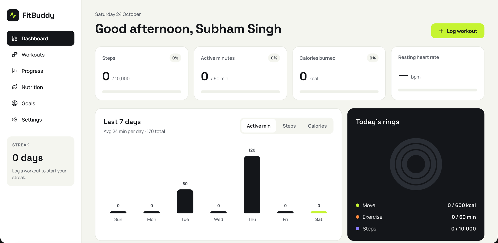

# FitBuddy

A self-hosted fitness tracker that syncs health data from an **Amazfit GTS 4 Mini**
(Zepp OS) watch and combines it with manual logging — workouts, nutrition, body
measurements, and goals — into a single dashboard.

```
Watch (Zepp OS app, reads sensors)
   │  BLE
   ▼
Zepp phone app (side service)
   │  HTTPS  POST /api/watch/sync   (x-api-key)
   ▼
FitBuddy server (Express + Mongoose)  ──►  MongoDB (fitbuddy)
   │  serves JSON API + built SPA
   ▼
Web app (React + Redux)
```

Metrics synced from the watch: **steps, calories, heart rate, sleep, stress, SpO2**.



## Stack

| Layer      | Tech |
|------------|------|
| Client     | React 19, Vite 8, Redux Toolkit, React Router 7, CSS Modules, lucide-react |
| Server     | Node ≥20, Express 4, Mongoose 9, Helmet, CORS, compression, express-rate-limit, morgan |
| Database   | MongoDB (Atlas or self-hosted) |
| Watch app  | Zepp OS 1.0 mini-app (`watchsyncapp/`) |
| Deploy     | Docker / docker-compose (single image serves API + SPA) |

## Repository layout

```
fitbuddy/
├── client/           # React (Vite) single-page app
│   └── src/
│       ├── app/            # Redux store + typed hooks
│       ├── components/     # layout (AppShell, Sidebar) + reusable UI
│       ├── features/       # dashboard, workouts, progress, nutrition, goals, settings, streak
│       └── services/       # per-feature API clients (fetch wrappers over /api/*)
├── server/           # Express + Mongoose JSON API
│   └── src/
│       ├── config/         # env, db connection, default targets, achievements
│       ├── controllers/    # request handlers per feature
│       ├── services/       # business logic / aggregation
│       ├── models/         # Mongoose schemas
│       ├── routes/         # feature routers mounted under /api
│       ├── middleware/     # rate limiting, watch auth, error handling
│       └── utils/          # payload sanitizers, HttpError, asyncHandler
├── watchsyncapp/     # Zepp OS watch app (see its own README)
├── Dockerfile        # multi-stage build → single production image
├── docker-compose.yml
└── .env.docker.example
```

## Features

- **Dashboard** — activity rings, 7-day charts, recent workouts, and weekly goal, composed from every data source.
- **Workouts** — a real weekly plan plus manual workout logging and history.
- **Progress** — trends, personal records, an activity heatmap, and body measurements.
- **Nutrition** — manual food/macro logging and water tracking against daily targets.
- **Goals** — custom goals with manual progress and a derived achievement/milestone engine.
- **Settings** — profile, unit preferences, and daily targets.
- **Workout streak** — current/longest streak surfaced in the sidebar.

## Getting started (local development)

Requires **Node ≥20** and a MongoDB connection string.

```bash
# 1. Install dependencies for root, client, and server
npm run install:all

# 2. Configure the server
cp .env.docker.example .env      # or create server/.env — see "Configuration"

# 3. Run client (Vite :5173) + server (Express :4000) together
npm run dev
```

The Vite dev server proxies `/api/*` to `http://localhost:4000`, so the client
calls the API without CORS fuss.

Other root scripts:

| Script | What it does |
|--------|--------------|
| `npm run dev`     | client + server together (via `concurrently`) |
| `npm run build`   | build the client → `client/dist` |
| `npm run start`   | start the server (serves the built SPA in production) |
| `npm run lint`    | lint the client (oxlint) |

## Configuration

Server environment variables (read in `server/src/config/env.js`):

| Variable | Required | Default | Notes |
|----------|----------|---------|-------|
| `NODE_ENV` | – | `development` | `production` serves the built SPA and tightens config checks |
| `PORT` | – | `4000` | |
| `CLIENT_ORIGIN` | – | `http://localhost:5173` | CORS origin; in prod the same origin as the app |
| `MONGO_URI` | one of these | – | Full connection string (takes precedence) |
| `MONGO_USERNAME` / `MONGO_PASSWORD` | one of these | – | Assembled into an Atlas SRV URI |
| `MONGO_HOST` | – | `cluster0.rgujunx.mongodb.net` | |
| `MONGO_DB` | – | `fitbuddy` | |
| `WATCH_KEY` | **prod** | – | Shared secret for watch sync; **≥24 random chars** in production |
| `OWNER_USER_ID` | – | `owner` | Single-user deployment: all watch syncs attribute here |
| `TRUST_PROXY` | – | `1` in prod, `0` in dev | Set when behind a tunnel/reverse proxy so rate limiting sees real IPs |
| `CLIENT_DIST` | – | `../../client/dist` | Where the server serves the built SPA from |

The server **fails fast on boot** (`validateConfig`) if the Mongo URI is missing,
or — in production — if `WATCH_KEY` is unset, too short, or still a placeholder.

Generate a watch key with:

```bash
openssl rand -hex 24
```

## Production deployment (Docker)

A single multi-stage image builds the client, installs server production
dependencies, and ships them together. The Express server serves both the JSON
API and the built SPA on one port.

```bash
cp .env.docker.example .env      # fill in MONGO_URI (or parts) + WATCH_KEY
docker compose up --build
```

The app is then reachable on `http://localhost:${PORT:-4000}`.

Prefer a throwaway local MongoDB instead of Atlas:

```bash
# starts the bundled mongo service; set MONGO_URI=mongodb://mongo:27017/fitbuddy in .env
docker compose --profile local-db up --build
```

Production hardening already wired in:

- Helmet security headers with a CSP tuned for the SPA (self-hosted JS, Google Fonts, inline style attributes for progress bars/rings).
- gzip compression, 1 MB JSON body cap, combined request logging.
- Rate limiting — 300 req / 15 min across the API, 10 req / min on the watch sync endpoint.
- Runs as the unprivileged `node` user under `dumb-init` for correct signal handling.
- `HEALTHCHECK` hitting `/api/health`; graceful shutdown on SIGINT/SIGTERM.

## API reference

All routes are mounted under `/api`.

| Method | Path | Auth | Purpose |
|--------|------|------|---------|
| `GET` | `/health` | – | Liveness probe |
| `POST` | `/watch/sync` | `x-api-key` | Upsert one daily-metrics doc per user per day (10/min) |
| `GET` | `/watch/status` | same-origin | Last-sync status |
| `GET` | `/metrics` · `/metrics/:date` | same-origin | Daily metrics for the dashboard |
| `GET`/`POST` | `/workouts` | same-origin | List / create workouts |
| `GET`/`PUT`/`DELETE` | `/workouts/:id` | same-origin | Read / update / delete a workout |
| `GET` | `/plan` | same-origin | Weekly plan |
| `PUT`/`DELETE` | `/plan/:date` | same-origin | Set / clear a plan day |
| `GET` | `/nutrition/:date` | same-origin | Food + water for a day |
| `POST`/`DELETE` | `/nutrition/food` · `/nutrition/food/:id` | same-origin | Log / delete food |
| `PUT` | `/nutrition/water` | same-origin | Set water intake |
| `GET`/`POST` | `/goals` | same-origin | List / create goals |
| `PUT`/`DELETE` | `/goals/:id` | same-origin | Update / delete a goal |
| `GET` | `/achievements` | same-origin | Derived milestone badges |
| `GET`/`PUT` | `/settings` | same-origin | Profile, units, targets |
| `GET` | `/progress` | same-origin | Derived trends + measurements |
| `POST` | `/progress/measurement` | same-origin | Log a body measurement |
| `GET` | `/dashboard` | same-origin | Composed landing-page view |
| `GET` | `/streak` | same-origin | Workout streak stats |

## Watch app

The Zepp OS watch app lives in `watchsyncapp/` and has its own
[README](watchsyncapp/README.md) covering build, Zepp OS 1.0 constraints, and
configuration. In short: the backend URL and API key are entered in the **Zepp
phone app → FitBuddy Sync → Settings** — no secrets are committed — and the API
key must match the server's `WATCH_KEY`.

## Notes

- **Single-user by design.** There is no auth/login on the web app; all watch
  syncs are attributed to `OWNER_USER_ID`. Deploy it behind your own access
  control if exposed publicly.
